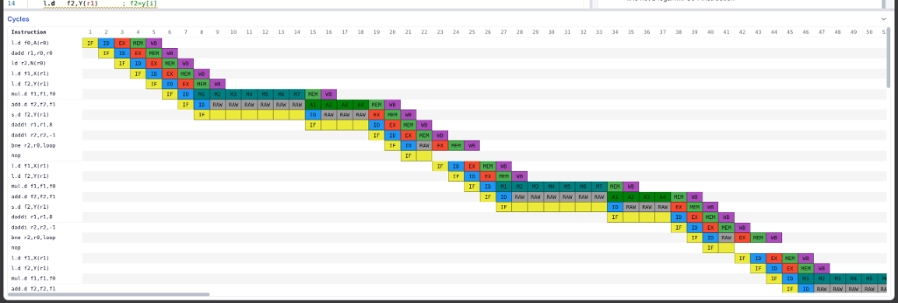

# MIPS64 Pipeline Optimization & Hazard Analysis

Cycle-accurate study of data and structural hazards and of software pipelining on a 5-stage MIPS64 pipeline, measured in eduMIPS64.


Each of the 17 programs is run with forwarding disabled and enabled (delay slot disabled), giving 34 measured configurations. Cycles, instructions, CPI and the RAW, WAW and structural stall counters are transcribed from the simulator's *Statistics* panel; the pipeline diagrams come from its *Cycles* panel. All 69 screenshots are kept in [`results/screenshots/`](results/screenshots).

## Key Results

Cycles as displayed by the simulator, baseline to optimized. Gain = (optimized - baseline) / baseline.

| Case | Optimization | Forwarding off | Gain | Forwarding on | Gain |
|---|---|---:|---:|---:|---:|
| `fib` -> `fib_reordered` | load elimination and reordering | 153 -> 102 | -33.3% | 111 -> 91 | -18.0% |
| `daxpy` -> `daxpy_unroll4` | unrolling by 4 | 309 -> 104 | -66.3% | 236 -> 104 | -55.9% |
| `alternating_update` -> `alternating_update_unroll2` | unrolling by 2 | 231 -> 116 | -49.8% | 181 -> 97 | -46.4% |
| `array_sum` -> `array_sum_unroll2` | unrolling by 2, two accumulators | 118 -> 81 | -31.4% | 104 -> 73 | -29.8% |
| `pow_naive` -> `pow_square_multiply` | square-and-multiply (x = 2, n = 5) | 57 -> 49 | -14.0% | 51 -> 43 | -15.7% |

The full table (all 17 programs, CPI and stall counters) is in [`results/RESULTS.md`](results/RESULTS.md); the same data is available as [`results/results.csv`](results/results.csv).

## Pipeline Timing Preview

`daxpy` against `daxpy_unroll4`, forwarding enabled: 236 cycles with 120 RAW stalls, against 104 cycles with 0 RAW stalls and 42 structural stalls.

| `daxpy` (baseline) | `daxpy_unroll4` (optimized) |
|---|---|
|  |  |

Baseline cycle diagram (forwarding on, first part), where each loop iteration shows the `RAW` stall bars between `mul.d`, `add.d` and `s.d`:



Only the baseline has cycle-diagram captures for `daxpy`; the optimized variant is documented by its *Statistics* panels.

## Optimization Analysis

- **Loop unrolling.** `daxpy_unroll4` and the `unroll2` variants process several elements per iteration, which removes loop-control instructions and gives the scheduler independent work to place between dependent operations. `alternating_update_unroll2` also resolves the even/odd test statically, dropping the parity test, branch and jump (118 to 76 instructions).
- **Load hoisting and reordering.** `fib_reordered` keeps F[n] and F[n+1] in registers instead of reloading them each iteration and places the counter update between the `add` and the `sw`. The instruction count is unchanged (78), while RAW stalls fall from 62 to 11 without forwarding and from 20 to 0 with forwarding.
- **Multiple accumulators.** `array_sum_unroll2` splits the serial `add.d` chain into two independent partial sums combined after the loop; RAW stalls fall from 38 to 11 (forwarding off) and from 12 to 3 (forwarding on).
- **Square-and-multiply.** `pow_square_multiply` scales as O(log n) multiplications. For n = 5 both versions execute five `mul.d`, so the gain comes from running the result chain and the squaring chain independently (RAW 28 -> 17 without forwarding), at the cost of a parity test and a shift per iteration (21 -> 23 instructions).
- **Structural stalls.** Structural stalls come from contention for the floating-point and memory units, not from unrolling alone: they already appear in the unmodified `array_sum` baseline (24 with forwarding), in `fp_double` (23 / 27) and in `pow_square_multiply` (4 / 6). Unrolled variants pack more FP and memory operations per iteration and show larger counts (`daxpy_unroll4`: 30 / 42), and forwarding does not remove them: `daxpy_unroll4` stays at 104 cycles with and without forwarding, as its RAW stalls fall from 6 to 0 while structural stalls rise from 30 to 42.
- **Forwarding.** Forwarding lowers the RAW stall count in every measured program.

## Methodology & Reproducibility (How to Run)

1. Open [eduMIPS64](https://www.edumips.org/) (the web simulator was used for the published measurements).
2. Load any `.s` file from `src/` into the code editor.
3. In the configuration settings, set **Forwarding** to *disabled* for the first run and *enabled* for the second, and keep **Delay Slot** *disabled* for both.
4. Parse the program and run it to completion (`halt`).
5. Read the *Statistics* panel (cycles, instructions, CPI, RAW / WAW / structural stalls) and open the *Cycles* panel for the pipeline diagram.
6. Compare the values with [`results/RESULTS.md`](results/RESULTS.md) or [`results/results.csv`](results/results.csv).

## Limitations

- Some *Statistics* panels in the web simulator display the warning "It is not a legal MIPS64 instruction" for WinMIPS64-style mnemonics; its effect on the measured counters is not established.
- The screenshots do not capture final memory contents, so numerical results (for example 32 for x = 2, n = 5) are not verified by the statistics panels.
- The power programs were measured only for the single case x = 2, n = 5.

## Repository Layout

```text
.
├── README.md
├── LICENSE
├── .gitignore
├── .gitattributes
├── src/
│   ├── microbenchmarks/   # int_add, int_mul, fp_add, fp_mul, fp_div, fp_abs, fp_double
│   ├── baseline/          # fib, daxpy, alternating_update, array_sum, pow_naive
│   └── optimized/         # fib_reordered, daxpy_unroll4, alternating_update_unroll2,
│                          # array_sum_unroll2, pow_square_multiply
└── results/
    ├── RESULTS.md         # full results table and screenshot index
    ├── results.csv        # 34 rows, machine-readable
    └── screenshots/       # 69 PNGs: microbenchmarks/, fibonacci/, daxpy/,
                           # alternating_update/, array_sum/, power/
```

## License

[MIT](LICENSE), Copyright (c) 2026 Mehdi Bouama.
